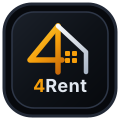

# 4Rent — Desktop & Mobile Apartment Rental & Dual Sub-Meter Management System

<p align="center">
  
</p>

<p align="center">
  <strong>A modern, cross-OS (MacBook, Windows, Linux, iOS & Android) Progressive Web Application (PWA) for apartment landlords and property managers.</strong><br/>
  <strong>🌐 Instant Live App (Works on Any OS/Device): <a href="https://splikaa.github.io/4Rent/">https://splikaa.github.io/4Rent/</a></strong>
</p>

---

## Instant Use on Any Device (MacBook, Windows, Linux, iPhone, Android)

You can use **4Rent** immediately on **any device or operating system** without installing anything:

1. **Instant Web & Installable PWA (Recommended for MacBook, iOS & Android)**:
   - Open **[https://splikaa.github.io/4Rent/](https://splikaa.github.io/4Rent/)** in Safari, Chrome, or Edge.
   - **On MacBook (macOS)**: In Safari/Chrome, click **Share → Add to Dock** (or click the **Install App** icon in the address bar) to run **4Rent** as a native desktop app.
   - **On iPhone / Android**: Tap **Share → Add to Home Screen** to install **4Rent** on your phone.
2. **Cross-Device Cloud Sync**:
   - Connect your **Supabase Cloud Sync** credentials in **Settings** (with a shared Property Code like `4RENT-MAIN`) so rooms, readings, receipts, and bookings sync across your MacBook, Windows PC, and mobile phone.

---

## Core System Rules & Architecture

**4Rent (`v1.1.0`)** enforces strict, landlord-tested operational rules:

1. **Dual Electric Sub-Meter Proofs on Every Official Receipt (`2 Sub-Meters`)**:
   - Every Official Receipt displays **2 Side-by-Side Sub-Meter Proofs**:
     1. **Sub-Meter #1 (Previous Reading Proof)**: Previous $\text{kWh}$ reading + meter snapshot.
     2. **Sub-Meter #2 (Current Reading Proof)**: Current $\text{kWh}$ reading + meter snapshot.
   - Shows the exact formula so tenants can legitimately verify their own consumption:
     $$\Delta \text{Consumption (kWh)} = \text{Current Reading} - \text{Previous Reading}$$
     $$\text{Electric Sub-Total (₱)} = \Delta \text{Consumption (kWh)} \times \text{Global Settings Rate (₱/kWh)}$$
2. **Centralized Settings Electric Rate**:
   - The Electric Sub-Meter Rate ($\text{₱/kWh}$) is configured **exclusively in Settings** and automatically reflects across every room and unpaid bill.
3. **Continuous $\text{kWh}$ Sub-Meter Reading Across Tenant Changes**:
   - When a tenant vacates or changes, the room's physical sub-meter reading (`lastMeterReading`) **continues seamlessly** without resetting to `0`.
4. **1 Room = 1 Active Official Receipt (Auto-Archive)**:
   - Each room holds **1 Active Official Receipt** directly accessible from the Room Card (`Open Receipt →`) for instant lookup. Whenever a new billing cycle receipt is generated for that room, older receipts are automatically moved to the **Archive Center**.
5. **Mandatory 1st–10th Monthly Payment Window**:
   - Tenant monthly due dates are strictly scheduled within **Day 1 to Day 10** of every month.
6. **Required Security Deposit & Withdrawable Advance Payment Balance**:
   - Every room requires a **Security Deposit (`₱`)**.
   - If a tenant pays **more** than the required Deposit or more than the exact Bill Amount Due, the excess is **automatically credited into the room's Advance Payment Balance**, which can be **withdrawn in cash/GCash** or **applied to future bills** depending on the tenant's decision.
7. **Automatic Previous Tenant History on Move-Out / Vacancy**:
   - If a tenant leaves or stops paying rent and the room turns `Vacant`, their record (move-in/move-out dates, reason, final $\text{kWh}$ reading, deposit held, and unpaid balance) is automatically saved to **Previous Tenants History**.
8. **Room Inquiries & Bookings**:
   - Track prospective tenant inquiries and room reservations (`Inquiry` / `Reserved / Booked`), record reservation fees, and convert a booking into an active room tenant in one click.
9. **PIN-Protected Room Removal & Archive Center**:
   - Removing a room requires **4-Digit Security PIN Authentication** (`Default PIN: 1234`, customizable in Settings).
   - Rooms and receipts can also be archived and restored anytime in **Archive & History**.

---

## Running Locally (Windows, macOS & Linux)

```bash
git clone https://github.com/splikaa/4Rent.git
cd 4Rent
npm install
npm run dev
```
- **Windows**: Double-click `Start-4Rent.bat`
- **MacBook / Linux**: Run `chmod +x start-4rent.sh && ./start-4rent.sh`

---

## License

Distributed under the **MIT License**. See [`LICENSE`](./LICENSE) for full details.
