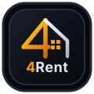

# 4Rent Management System

<p align="center">
  
</p>

<p align="center">
  <strong>Property, Sub-Meter &amp; Rental Billing Suite for Windows, macOS, Android, and iOS</strong><br/>
  Version <code>v1.0.1</code> • Built by <a href="https://github.com/splikaa">splikaa</a>
</p>

---

## Client Installation (No Node.js or CLI Required)

End users can install and run **4Rent** directly from the pre-built packages in this repository or from the **Download Apps** dialog inside the web app ([`https://splikaa.github.io/4Rent/`](https://splikaa.github.io/4Rent/)).

### 1. Windows Desktop (`Windows 10 / 11`)
- **Package**: [`4Rent-Desktop-Windows.zip`](./4Rent-Desktop-Windows.zip) or [`packages/desktop/4Rent-Launcher.exe`](./packages/desktop/4Rent-Launcher.exe) (~44 KB)
- **Setup**:
  1. Download and extract `4Rent-Desktop-Windows.zip` (or download `4Rent-Launcher.exe` directly).
  2. Double-click **`4Rent-Launcher.exe`** (runs under standard user privileges; no administrator prompt).
  3. Click **Launch 4Rent Standalone Desktop App** to open a dedicated borderless desktop window, or click **Pin to Desktop** to create a desktop shortcut with the official icon.

### 2. macOS Desktop (`Apple Silicon M1–M4 & Intel`)
- **Package**: [`4Rent-Desktop-macOS.zip`](./4Rent-Desktop-macOS.zip) or [`packages/desktop/Install-4Rent-macOS.command`](./packages/desktop/Install-4Rent-macOS.command) (~171 KB)
- **Setup (Option A — Native `.app` Bundle)**:
  1. Download and unzip **`4Rent-Desktop-macOS.zip`** (Safari extracts it automatically in `Downloads`).
  2. Double-click **`4Rent.app`** and select **Install to Applications & Launch** in the native macOS dialog, or drag **`4Rent.app`** directly into your **`Applications`** folder.
- **Setup (Option B — 1-Click Installer)**:
  1. Double-click **`Install 4Rent to Applications.command`** (or `Install-4Rent-macOS.command`).
  2. The installer copies `4Rent.app` into `/Applications`, clears macOS Gatekeeper quarantine attributes (`xattr -cr`), places a shortcut on your Desktop, and launches the app.

### 3. Android Mobile (`Android 7.0+`)
- **Package**: [`4Rent-v1.0.1-release.apk`](./4Rent-v1.0.1-release.apk) (also in [`packages/mobile/4Rent-v1.0.1-release.apk`](./packages/mobile/4Rent-v1.0.1-release.apk))
- **Setup**:
  1. Download `4Rent-v1.0.1-release.apk` on your phone and open it from your notification bar or **Files / Downloads**.
  2. Allow installation from your browser/file manager if prompted, then tap **Install**.
  3. Grant camera permission on first scan to use the live sub-meter OCR viewfinder.

### 4. iPhone & iPad (`iOS Safari`)
- **Setup**:
  1. Open [`https://splikaa.github.io/4Rent/`](https://splikaa.github.io/4Rent/) in **Safari**.
  2. Tap **Share** → **Add to Home Screen** → **Add**.
  3. Launch **4Rent** from your Home Screen for full-screen standalone mode with offline storage and camera OCR.

---

## Billing Rules & Core Capabilities

### Monthly Payment Window & Late Charges (Day 11+)
- **Payment Window**: Days **1–10** of each billing month (Due Date: **10th**). No late charges apply on Days 1–10.
- **Daily Divided Value & Late Charges**:
  - Daily divided rent uses exact 2-decimal centavo floor division:
    $$\text{Daily Rate} = \frac{\lfloor (\text{Monthly Rent} \times 100) \div \text{Days in Month} \rfloor}{100}$$
  - Example (`₱5,000` rent in a `30`-day month): `₱5,000 ÷ 30 = ₱166.66/day`.
  - Starting strictly on **Day 11**, unpaid rent accumulates the exact daily divided value per late day (`Day 11 = ₱166.66`, `Day 12 = ₱333.32`, `Day 13 = ₱499.98`), or uses a custom Fixed (`₱`) / Percentage (`%`) rate configured in **Settings → Monthly Rent Payment Schedule & Late Charges**.
- **Calendar Proration**: Mid-month move-ins and move-outs prorate across 28, 29 (leap year), 30, and 31-day months using the exact truncated daily rate (`dailyRate × occupiedDays`), while full-month occupancy charges the exact monthly rent.

### Mandatory Sub-Meter Verification & Component Ledger
- **Dual Sub-Meter Proof**: Each bill stores `#1 Previous` and `#2 Current` kWh readings alongside full meter photos and zoomed register crops.
- **Verification Gate**: Final bill generation requires a verified current sub-meter reading, blocks duplicate active bills per `(roomId, billingMonthKey)`, and rejects negative kWh deltas unless a meter rollover or reset reason is documented.
- **Independent Component Tracking**: Rent, Electricity, Late Charges, and Carry-Over balances are tracked separately. Paying rent alone keeps the statement marked **`PARTIAL`** until electricity charges are paid in full.
- **Independent Monthly Electric Rates**: Each `YYYY-MM` billing period stores its own `₱/kWh` rate without altering prior months or settled receipts.

### Advance Credit & Security Deposit Controls
- **Overall Balance Gate**: The **Advance Credit** button on room cards, room details, and payment records appears only after the tenant has settled their overall balance (`unpaidBalance <= 0` and active bill `status === 'paid'`).
- **PIN / Biometric Protection**: Overpayments credited to the Advance Wallet, advance refunds, and permanent room deletions require 4-Digit PIN or biometric confirmation.

### Offline-First Storage & Mobile ↔ Desktop Synchronization
- **Local Persistence**: All rooms, readings, meter image proofs, receipts, and settings are stored locally in **IndexedDB** (`v3`) and **localStorage**, allowing full offline operation.
- **Offline-to-Online Auto-Sync**: Changes made while offline on Mobile or Desktop are flagged in a persistent sync queue (`4rent_pending_offline_sync`). When Wi-Fi or Mobile Data reconnects, the app automatically pulls the remote snapshot, merges offline rooms/bills/readings, and pushes the combined state to Firebase Realtime Database.
- **Cross-Device Configuration Sync**: Updating Configurations (electric rates, monthly rate schedules, late charges rules, default rent, apartment details) on either Mobile or Desktop timestamps `settings.updatedAt` and applies the newer configuration across synced devices while keeping unlock PINs and biometric credentials strictly local to each device.

---

## Environment Variables (Optional Custom Firebase Instance)

No API keys or secrets are committed to this repository. To point a local build at your own Firebase Realtime Database:

```bash
cp .env.example .env.local
```

```env
VITE_FIREBASE_PROJECT_ID=your-project-id
VITE_FIREBASE_DATABASE_URL=https://your-project-id-default-rtdb.firebaseio.com
VITE_FIREBASE_API_KEY=your_optional_database_secret_or_token
VITE_PROPERTY_CODE=YOUR-SPACE-CODE
```

---

## Developer Commands & Repository Structure

```bash
# Install dependencies
npm install --legacy-peer-deps

# Run the 45-test suite (financial math, proration, late charges, OCR, storage, sync, UI)
npm test

# Start local development server
npm run dev

# Build production web bundle + macOS zero-CLI application bundle (4Rent-Desktop-macOS.zip)
npm run build

# Build and sign the Android release APK (requires ANDROID_KEYSTORE_PASSWORD)
npm run build:apk
```

```text
├── build/                          # Master icons (.icns, .ico, .png) & macOS entitlements
├── electron/                       # Optional Electron desktop host (main.cjs, preload.cjs)
├── mobile_app/                     # Android WebView wrapper source & APK template
├── packages/
│   ├── desktop/
│   │   ├── 4Rent-Desktop-Windows.zip
│   │   ├── 4Rent-Desktop-macOS.zip
│   │   ├── 4Rent-Launcher.exe
│   │   ├── Install-4Rent-macOS.command
│   │   └── src/LauncherProgram.cs
│   └── mobile/
│       └── 4Rent-v1.0.1-release.apk
├── scripts/
│   ├── build_macos_app.mjs         # Generates 4Rent.app bundle & 4Rent-Desktop-macOS.zip
│   ├── build_signed_apk.mjs        # Injects compiled web bundle & signs Android release APK
│   └── run_tests.mjs               # Node test runner
├── src/
│   ├── components/                 # Dashboard, Rooms, OCR Scanner, Receipts, Calendar, Settings
│   ├── services/                   # IndexedDB, localStorage, Firebase RTDB sync & space switch
│   ├── types/                      # TypeScript domain models
│   └── utils/                      # Centavo financial engine, rent schedule, OCR & PDF export
└── tests/                          # Automated unit & integration test suites
```

---

## License

Released under the [MIT License](./LICENSE).
